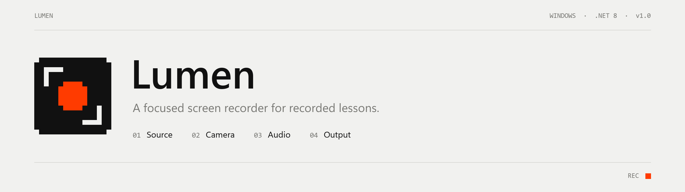
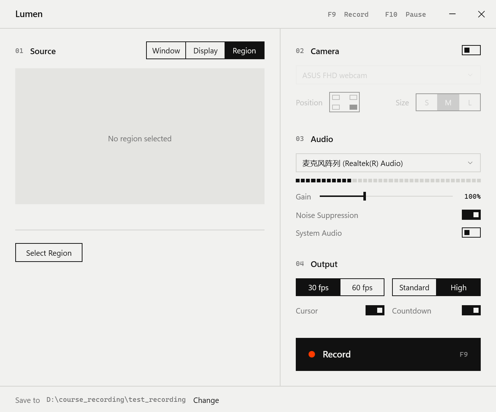

<picture>
  <source media="(prefers-color-scheme: dark)" srcset="docs/banner-dark.png">
  
</picture>

<p>
  <a href="https://github.com/Shengwei-Li/lumen/releases/latest"></a>
  
  
  <a href="LICENSE"></a>
</p>

Lumen records one window, one display or one region of the screen, with an optional camera
overlay and a clean voice track. It was built for recording lessons: pick the slide deck or PDF
you are teaching from, press F9, and nothing else on the desktop ends up in the video.



## Features

| | |
|---|---|
| **Window capture** | Records a single window, even when other windows cover it. Notifications and pop-ups stay out of the video. |
| **Display and region** | Full display, or a dragged region. Hold Shift to lock 16:9. |
| **Camera overlay** | Picture-in-picture in any corner, three sizes. |
| **Noise suppression** | RNNoise runs on the microphone as you record. The clean track is aligned to the video afterwards, block by block. |
| **System audio** | Mixes in what the computer plays, such as listening material. |
| **Cursor** | Shown or hidden in the recording. |
| **Hardware encoding** | H.264 through Media Foundation, 30 or 60 fps, variable frame rate. |
| **Crash-safe files** | Fragmented MP4, written by a separate recorder process. A recording interrupted by a crash or power loss stays playable. |

The recording controls never appear in the video.

## Download

Get the latest build from [Releases](https://github.com/Shengwei-Li/lumen/releases/latest).

| File | Size | |
|---|---|---|
| `Lumen-<version>-Setup.exe` | ~50 MB | Installer. Per-user, no administrator rights needed. |
| `Lumen-<version>-win-x64-portable.zip` | ~70 MB | Unzip anywhere and run `Lumen.exe`. |

Both include the .NET runtime. They need the
[Microsoft Visual C++ Redistributable](https://learn.microsoft.com/cpp/windows/latest-supported-vc-redist) (x64),
which most Windows installations already have; the installer checks for it.

The builds are not code-signed, so Windows SmartScreen may ask for confirmation on first run:
choose **More info**, then **Run anyway**.

## Shortcuts

| Key | Action |
|---|---|
| `F9` | Start or stop recording |
| `F10` | Pause or resume, while recording |
| `Shift` | Lock region selection to 16:9 |
| `Esc` | Cancel region selection |

Recordings are saved as `yyyy-MM-dd HH.mm <source>.mp4` in the folder shown at the bottom of the
window. Settings live in `%APPDATA%\Lumen`.

## Build

```bash
dotnet publish -c Release -o publish
```

Requires the .NET 8 SDK on Windows. To build the installer and the portable zip into
`artifacts/` (needs [Inno Setup 6](https://jrsoftware.org/isinfo.php)):

```bash
powershell -ExecutionPolicy Bypass -File installer/build.ps1
```

## How it works

```
UI process (WPF)                         Recorder process (lumen --engine)
├─ source picker, live DWM preview       └─ ScreenRecorderLib
├─ microphone tap                            Windows.Graphics.Capture
│   WASAPI → 48 kHz → RNNoise → WAV          Media Foundation H.264 + AAC
│   + raw reference for alignment            fragmented MP4
└─ finisher
    cross-correlates the reference with the recorder's own audio,
    then rewrites the MP4 with the clean track (video is copied, not re-encoded)
```

The recorder runs in its own process so that a stuck encoder can be stopped without losing the
file or the app. If the clean track cannot be aligned with confidence, the original audio is kept.

## Acknowledgements

[ScreenRecorderLib](https://github.com/sskodje/ScreenRecorderLib) (MIT) ·
[NAudio](https://github.com/naudio/NAudio) (MIT) ·
[RNNoise](https://github.com/xiph/rnnoise) (BSD-3-Clause) via
[RRNoise.NET](https://www.nuget.org/packages/YellowDogMan.RRNoise.NET) (MIT)

## License

[MIT](LICENSE)
